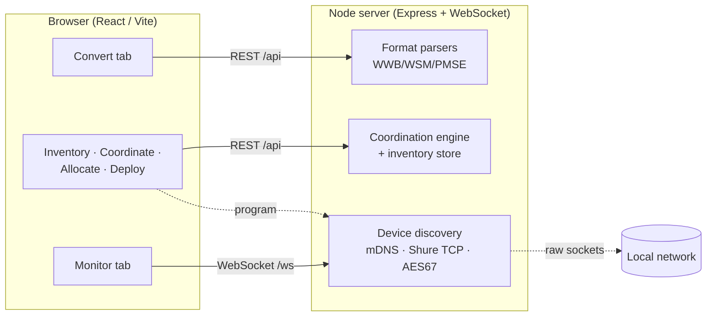

# RFutils

> **AI-assisted project.** This codebase was created with [Claude Code](https://claude.com/claude-code)
> (Anthropic), directed and reviewed by a human author. It's three earlier tools merged into one
> package. Several of the formats and protocols underneath are reverse-engineered from real exports
> and vendor gear rather than official schemas, since neither Shure nor Sennheiser publishes full
> specs for most of them. **Check every export against your own WWB/WSM install, and go over the
> experimental outputs carefully, before you rely on any of this for a live show.**

RFutils is a browser-based RF coordination and wireless-mic suite. It brings three separate tools
together in one package, with room to grow into full frequency coordination, allocation and
deployment:

[](https://www.youtube.com/watch?v=8f6VZ9qt1kw)

*A 50-second tour. Every frame is the app itself: an actual 291-channel Wireless Workbench report
goes into Convert, and the eight frequencies in Coordination are worked out live. The receivers in
Monitor are the app's mock devices, as there wasn't a wireless rack attached.*

| Merged tool | What it did | Where it lives now |
|---|---|---|
| [wsm-wwb-bridge](https://github.com/stoatworks-labs/wsm-wwb-bridge) | Move coordination data between Shure Wireless Workbench (WWB) and Sennheiser Wireless Systems Manager (WSM), plus any CSV | **Convert** (drop the file) |
| [pmse-to-wwb](https://github.com/stoatworks-labs/pmse-to-wwb) | Convert an Ofcom PMSE licence schedule PDF into WWB import files | **Convert** (drop the PDF) |
| [MicWizard](https://github.com/stoatworks-labs/MicWizard) | Discover networked Shure/Sennheiser/AES67 receivers and monitor audio / battery / RF | **Monitor** |

**All three are retired in favour of RFutils**, which now covers everything they did. Their
repositories were archived on 11 October 2026 and stay up with their past releases, but new work
happens here. Moving
across? See [Coming from MicWizard or wsm-wwb-bridge](#coming-from-micwizard-or-wsm-wwb-bridge).



Everything goes through **one internal channel model** (`packages/shared`), so any input it reads
can go back out as any output it writes, and the same model feeds coordination, allocation and
deployment.


<!-- downloads:start -->

## Download

**[v0.5.2](https://github.com/stoatworks-labs/RFutils/releases/tag/v0.5.2)** — prebuilt for macOS, Windows and Linux. Pick your platform:

<details>
<summary><b>macOS</b> — Universal (Apple Silicon + Intel)</summary>

| Build | Download | Size |
| --- | --- | --- |
| Universal (Apple Silicon + Intel) · .dmg disk image | [`rfutils-0.5.2-macos-universal.dmg`](https://github.com/stoatworks-labs/RFutils/releases/download/v0.5.2/rfutils-0.5.2-macos-universal.dmg) | 84 MB |
| Universal (Apple Silicon + Intel) · .pkg installer | [`rfutils-0.5.2-macos-universal.pkg`](https://github.com/stoatworks-labs/RFutils/releases/download/v0.5.2/rfutils-0.5.2-macos-universal.pkg) | 84 MB |

</details>

<details>
<summary><b>Windows</b> — x64</summary>

| Build | Download | Size |
| --- | --- | --- |
| x64 · .exe installer | [`RFutils_0.5.2_x64-setup.exe`](https://github.com/stoatworks-labs/RFutils/releases/download/v0.5.2/RFutils_0.5.2_x64-setup.exe) | 26 MB |
| x64 · .msi installer | [`RFutils_0.5.2_x64_en-US.msi`](https://github.com/stoatworks-labs/RFutils/releases/download/v0.5.2/RFutils_0.5.2_x64_en-US.msi) | 38 MB |

</details>

<details>
<summary><b>Linux</b> — x64</summary>

| Build | Download | Size |
| --- | --- | --- |
| x64 · .deb package (Debian/Ubuntu) | [`RFutils_0.5.2_amd64.deb`](https://github.com/stoatworks-labs/RFutils/releases/download/v0.5.2/RFutils_0.5.2_amd64.deb) | 52 MB |
| x64 · .rpm package (Fedora/RHEL) | [`RFutils-0.5.2-1.x86_64.rpm`](https://github.com/stoatworks-labs/RFutils/releases/download/v0.5.2/RFutils-0.5.2-1.x86_64.rpm) | 52 MB |

</details>

Also in this release:

- [`rfutils-node-bundle.tar.gz`](https://github.com/stoatworks-labs/RFutils/releases/latest/download/rfutils-node-bundle.tar.gz) — Node bundle (run it yourself), 590 KB

All builds, checksums and release notes: [github.com/stoatworks-labs/RFutils/releases](https://github.com/stoatworks-labs/RFutils/releases).

macOS builds are signed and notarised and open normally. The Windows builds are unsigned, so SmartScreen warns once — see [Windows SmartScreen & Defender Firewall](#windows-smartscreen--defender-firewall) for the one-time click-through.

<!-- downloads:end -->

## Try it without installing anything

The conversion and coordination half of RFutils runs entirely in a browser, hosted at
**<https://rfutils.stoatworks-labs.com>**. Drop in a WWB/WSM export or an Ofcom PMSE licence PDF
and get your files back. **Nothing is uploaded**: the parsers, the `.shw` generator and the
coordination engine all run on your own machine, in the page, so your licence PDF never leaves
your laptop.

The hosted build has **Convert, Coordination, Inventory and Allocation**. It doesn't have
**Monitor** or **Deployment**: discovering receivers (mDNS), decoding AES67 audio and programming
frequencies over TCP all need sockets a web page can't open. For those, run RFutils locally.

## Coming from MicWizard or wsm-wwb-bridge

### wsm-wwb-bridge → Convert

- Everything the bridge read and wrote is in **Convert**: drop the file, check the preview, pick
  the export. An unrecognised CSV gets the same column-mapping step. It also runs in the hosted
  page above, with nothing to install.
- **You get the bridge's output.** RFutils' test suite checks every reader and all four writers
  against what the bridge's own Python produced for the sample files it publishes, byte for byte,
  and brings its unit tests across assertion for assertion. The two places the TypeScript port
  used to differ now match the bridge: a frequency exactly halfway between two kHz values
  (512.0625 MHz is 512.062, rounded to even, as Python does) and a WWB group/channel written with
  spaces (`G: 01 Ch: 05`). The seven real vendor exports in RFutils' test fixtures come out
  identical in both tools too.
- **One difference is on purpose: the WSM CSV.** The bridge left its priority and squelch level
  columns empty, and WSM 4.9.0 won't import the file like that. RFutils writes what WSM's own
  export writes for a frequency left at its defaults (priority 2, Medium; squelch level 5; LF line
  endings, where the bridge wrote CRLF), and puts 0, a discrete frequency, in the type column where
  the bridge put a Shure model name. The export bar lets you pick High or Low priority instead.
- The bridge didn't keep any settings, so there's nothing to migrate.

### MicWizard → Monitor

- **Monitor is MicWizard's main view**: discovery, audio/RF meters, battery, the headphone cue,
  Dante routing through Companion, and **Diagnostics** (at the bottom of every page).
- It's a web app now. Start the desktop app and **open it on the same machine as
  `http://localhost:8420`** (`http://localhost:5273` under `npm run dev`) for the headphone cue.
  Browsers only allow audio devices on `localhost` or HTTPS, not on `http://192.168.x.x`.
- **Your Companion setup moves.** MicWizard read `companion-routes.json` from
  `~/Library/Application Support/MicWizard/` (macOS; `%APPDATA%\MicWizard\` on Windows,
  `~/.config/MicWizard/` on Linux). RFutils reads `~/.rfutils/companion-routes.json`, or the
  directory in `RFUTILS_CONFIG_DIR`. The file's the same shape, so your Companion buttons keep
  working: while RFutils has no config of its own, the Monitor tab offers **Import from
  MicWizard**, which copies it across once and never overwrites one. By hand, it's:

  ```bash
  mkdir -p ~/.rfutils
  cp ~/Library/Application\ Support/MicWizard/companion-routes.json ~/.rfutils/
  ```

- **USB-input mappings don't carry over**, because MicWizard kept them inside its own window.
  Click 🎧 on each analogue channel once to map it again.
- MicWizard's last two monitoring fixes are in RFutils too: Sennheiser receivers found over mDNS
  are connected to and metered, and a Shure channel name with a space in it no longer freezes that
  channel's meters. Neither has been run against a real receiver yet.

## Architecture

An npm-workspaces monorepo:

- **`packages/shared`** holds the internal data model and wire types (`Channel` /
  `CoordinationList`, PMSE `Assignment`, `DiscoveredDevice`, the WebSocket protocol) **and all
  the pure logic**: the WSM/WWB/CSV parsers and writers (`shared/formats`), the PMSE PDF parser,
  exporters and `.shw` generator (`shared/pmse`), and the coordination engine
  (`shared/coordination`). None of it touches a Node API, which is what lets the same code run
  on the server and in the browser.
- **`packages/server`** is a Node ([Express](https://expressjs.com) + [ws](https://github.com/websockets/ws))
  server. It serves the shared logic over `/api` **and** owns the raw sockets a browser can't
  open: mDNS, Shure's TCP command protocol, and AES67/SAP multicast.
- **`packages/web`** is the React/Vite single-page app (MicWizard's renderer, ported, plus a new
  conversion UI). It's built twice: against the server (`npm run build`), and standalone for
  hosting (`npm run build:static`), where `src/localApi.ts` calls the shared logic directly
  instead of `fetch('/api/…')`.

The two file tools started out in Python (a tkinter desktop app and a FastAPI service). Their
parsers were ported to TypeScript and are held to the originals' output:
[`bridgeGolden.test.ts`](packages/server/test/bridgeGolden.test.ts) compares every reader and
writer with what wsm-wwb-bridge's own Python produced for its published sample files
([`bridge-golden/`](packages/server/test/bridge-golden/), regenerated by `generate.py` there), and
[`bridgeParity.test.ts`](packages/server/test/bridgeParity.test.ts) is the bridge's unit-test suite,
ported assertion for assertion. The PMSE parser was validated against a real Ofcom licence.
MicWizard's networking was already TypeScript, and moved from its Electron main process into this
server largely intact, tests and all.

## Running it

Needs Node 22.13 or newer (I develop against Node 22/26).

```bash
npm install
npm run dev          # server on :8420, web on :5273 (Vite proxies /api and /ws to the server)
```

Then open http://localhost:5273.

For a production build served from a single port:

```bash
npm run build
npm start -w @rfutils/server   # serves the built UI + API on :8420
```

Other scripts: `npm run typecheck` (all packages), `npm test` (server parser tests),
`npm run dev:demo` (like `dev`, but seeds simulated receivers so the Monitor tab fills up
without any hardware, which is how the Monitor screenshot was captured).

To build the browser-only version:

```bash
npm run build:static     # -> packages/web/dist-static
npm run preview:static -w @rfutils/web   # serve that build locally
```

It's published to a **static-assets-only Cloudflare Worker** (`wrangler.toml`, worker
`rfutils`, serving `packages/web/dist-static`). A push to `main` deploys it through
`.github/workflows/deploy.yml` (docs-only pushes are skipped), which runs the tests, builds it,
smoke-checks the page and then runs `wrangler deploy`. By hand, it's:

```bash
npm run build:static
cf-run npx wrangler deploy
```

**`wrangler deploy` doesn't run a build.** It uploads `packages/web/dist-static` as it finds it,
so the build has to come first. Skip it and the deploy reports a clean success while cheerfully
republishing the previous build.

The build targets a root base path, since the worker serves at the root of its own domain.
Set `RFUTILS_BASE=/somewhere/` to host it under a subdirectory instead.

### Environment

- `RFUTILS_SERVER_PORT`: server port (default `8420`).
- `RFUTILS_DISABLE_MONITOR=1`: skip network device discovery (file conversion still works).
- `RFUTILS_MOCK_DEVICES=1`: seed simulated receivers into the Monitor dashboard (demo/dev).
- `RFUTILS_CONFIG_DIR`: where `companion-routes.json` is read from (default `~/.rfutils`).
- `RFUTILS_CAPTURE_DEVICE` / `_FORMAT` / `_CHANNEL` / `_RATE`, `RFUTILS_FFMPEG`,
  `RFUTILS_CAPTURE_CMD`, `RFUTILS_CUE_BUS_DEVICE` / `_CHANNEL`, `RFUTILS_CUE_SRC_DEVICE`: audio
  capture (DVS/Dante interface) cue mode; see [Audio cueing](#audio-cueing-to-headphones).

### Desktop app

Rather not touch the terminal? A small menu-bar app lets you pick the network interface and
port, start and stop the server, and open the web UI. It's **fully self-contained**: the `.dmg`
embeds a Node runtime plus the whole app (server and built web UI), so there's nothing to
install, not even Node. Grab it from
[Releases](https://github.com/stoatworks-labs/RFutils/releases), or see
[launcher/](launcher/) to build it. Released builds are Developer ID-signed and
notarised, so the `.dmg` opens normally. The Windows first-launch and firewall
prompts are covered in
[Windows SmartScreen & Defender Firewall](#windows-smartscreen--defender-firewall),
and [launcher/SIGNING.md](launcher/SIGNING.md) covers signing a copy you build
yourself.

<p align="center"></p>

### Diagnostics

If something goes wrong, open **Diagnostics** at the bottom of the page and press **Collect
diagnostics**. Your browser downloads one JSON file holding the logs, the version, the settings
with anything password-shaped removed, and any recent crash report. Attach that to the bug
report. A copy is kept on the machine RFutils runs on (`~/Library/Logs/rfutils/` on macOS), and
**Open log folder** shows it. From a terminal, `npm start -w @rfutils/server -- --collect-diagnostics`
writes the same file and prints its path. See [docs/diagnostics.md](docs/diagnostics.md).

## Convert

One drop zone takes everything below. RFutils reads the file's own bytes to decide what it is (a
PDF goes to the Ofcom licence parser, anything else to the coordination-file detector), so
there's nothing to pick first, and a licence dragged straight out of an email with no extension
still lands in the right place.

### Coordination files (WSM · WWB · CSV)

Drop a file and RFutils works out its shape, shows you the parsed channels, and lets you
re-export them to any supported format:

**Reads:** Shure `.shw` / `.cws` (native WWB XML), Sennheiser `.wsm` project files, WSM HTML
"Coordination Report", WSM Frequencies/Bands CSV, WWB Coordination Report CSV, a bare frequency
list, or any other CSV through a column-mapping dialog. The dialog appears even when it couldn't
guess any of the headers, so an unfamiliar spreadsheet is a mapping away rather than a dead end.

**Writes:** WWB frequency list (`.txt`, the safe documented import format), WWB inventory CSV,
WSM Frequencies/Bands CSV (at the priority you pick), a generic CSV, or an experimental WWB7
`.shw` show file.

### Ofcom PMSE licence (PDF)

Drop an Ofcom PMSE licence schedule PDF into the same zone to get a WWB frequency list
(`.txt`), a reference sheet (`.csv`) mapping frequencies to suggested names and coordination
groups, and an experimental `.shw` show file.


*The screenshot uses a synthetic licence with invented details, not a real one.*

> **PDF parsing.** The original `pmse-to-wwb` used Python's `pdfplumber` for table detection.
> `pdfjs-dist` has no table detector, so this port buckets positioned text into the fixed Ofcom
> ST16 template's columns (scaled by page width) and merges the several physical lines in each
> row. It's been validated against a real Ofcom PMSE licence schedule: all 116 assignments,
> frequencies, sites, periods, fees and header metadata parse correctly. The column geometry is
> calibrated to that fixed template, and a materially different revision of it from Ofcom would
> need recalibrating, so it's still worth sanity-checking the parsed assignments against the
> source PDF.

> ⚠️ The `.shw` show file (both here and in the coordination exporter) is reverse-engineered from a
> single real WWB7 file and hasn't been validated by Shure. Open it in Wireless Workbench and check
> it before relying on it for a real show; when in doubt, use the frequency list.

## Monitor

Monitor finds wireless receivers on the local network and meters them live: Shure (TCP command
strings, port 2202), Sennheiser (SSC) and AES67/Dante (mDNS + SAP), with per-channel audio,
battery and RF telemetry pushed to the browser over WebSocket.


*Captured with `RFUTILS_MOCK_DEVICES=1` (simulated receivers), with no actual hardware on the network. The highlighted headphone button on an AES67 channel is an active audio cue.*

> **Not yet hardware-tested.** As in MicWizard, the vendor protocol adapters are built from a mix
> of public documentation and best-effort reverse engineering, and haven't been validated against
> real receivers. The Sennheiser SSC adapter in particular is a skeleton: it connects to every
> receiver mDNS finds and reads its metering every second, but the SSC paths it reads are
> unverified guesses, only tested against a fake receiver on localhost.
>
> [`docs/SHURE-ACN.md`](docs/SHURE-ACN.md) doesn't change that. It *is* built from real Shure
> QLXD4 hardware, but it documents a **different protocol** (ANSI E1.17 / ACN, the path a Yamaha
> console uses when a receiver is mounted on it), not the Command Strings interface these adapters
> speak. So real gear was on the network, and it still didn't test this code.

**Got gear I don't support?** Wisycom, Sony DWX, Sound Devices and MiPro all have proper network
control protocols, and nobody has published any of them. The Lectrosonics adapter is already
written and waiting on [one file's worth](packages/server/src/monitor/discovery/lectrosonicsProtocol.ts)
of correct wire format. Five minutes of a receiver doing something ordinary, recorded with
Wireshark, is enough to start from. **[docs/capture-guide.md](docs/capture-guide.md)** walks you
through it. For most people it's "run Wireshark on the same laptop as the vendor software" and
nothing else, and there's a mirror-port recipe for when it isn't. [`docs/BRANDS.md`](docs/BRANDS.md)
lists what's supported today.

There's a 57-second video on why, covering this project and
[Dante-BabelBox](https://github.com/stoatworks-labs/Dante-BabelBox) together:
**[Send us a capture](https://www.youtube.com/watch?v=E-gjYZoHVAw)**.

### Audio cueing to headphones

A browser can't join a Dante/AES67 multicast group directly, so cueing network audio to
headphones works by **relay**: the server sends a cued channel to the browser as PCM16 mono over
its own binary WebSocket (`/ws/audio`), and an `AudioWorklet` ring buffer plays it out with a
small jitter buffer. Only cued channels are streamed (~0.77 Mbit/s each at 48 kHz).

The **cue bar** above the receivers sets how it plays:

- **Solo** (the default): one channel at a time, so a new cue replaces the last, like a hardware
  PFL/cue bus. Untick it to **Mix** several, each with its own meter.
- **Output**: headphones, a USB interface, any output the OS offers. Chrome and Edge can choose;
  Safari and Firefox play through the system output. The choice is remembered per browser.

**Open RFutils as `http://localhost:<port>` on the machine it runs on** (or over HTTPS) to cue at
all: browsers only allow audio devices and the `AudioWorklet` on a secure page, and
`http://192.168.x.x` isn't one. The cue bar says so when it can't.

There are three ways to get a channel's audio to the cue:

**1. Capture mode: a Dante interface (DVS) + Companion (recommended).** Let a vendor Dante
endpoint do the decode and let Companion do the routing:

```
Mic TX ──(Dante)──▶ [Companion re-points one crosspoint] ──▶ DVS / Dante interface "cue" Rx channel
                                                                       │  (local audio device)
                                                                       ▼
                                    RFutils server captures that channel with ffmpeg ──PCM16/WS──▶ browser 🎧
```

Clicking 🎧 on any channel asks Companion, best effort, to route it to the cue-bus destination,
then streams the captured bus. That hands the Dante decode to supported vendor software and
reuses the Companion integration below. Turn it on by pointing the server at the interface's
input:

- `RFUTILS_CAPTURE_DEVICE`: ffmpeg input device (e.g. `":2"` for an avfoundation index on macOS;
  list devices with `ffmpeg -f avfoundation -list_devices true -i ""`). Setting this switches the
  app into capture mode, and **every** channel becomes cueable.
- `RFUTILS_CAPTURE_FORMAT`: ffmpeg input format (default `avfoundation`/`dshow`/`alsa` by OS).
- `RFUTILS_CAPTURE_CHANNEL`: 0-based input channel to use as the cue bus (default `0`).
- `RFUTILS_CAPTURE_RATE`: sample rate (default `48000`); `RFUTILS_FFMPEG`: ffmpeg path.
- `RFUTILS_CAPTURE_CMD`: full override, any command emitting `s16le` mono to stdout (bypasses the
  ffmpeg args above). `npm run dev:capture-demo` uses this with a `sox` test tone.
- `RFUTILS_CUE_BUS_DEVICE` / `RFUTILS_CUE_BUS_CHANNEL`: the Dante Controller destination Companion
  routes mics to (the DVS Rx channel the server captures). Without these, cueing just streams the
  bus and you route by hand. The source name sent to Companion is the discovered channel's name
  (override the device with `RFUTILS_CUE_SRC_DEVICE`); **these must match your Dante Controller
  labels** for auto-routing to hit the right crosspoint. ffmpeg needs installing (`brew install
  ffmpeg`). A fast/bursty source is throttled to real time by a server-side pacer.

**2. Direct AES67 mode (default, no config).** If no capture device is set, the server decodes
AES67 multicast itself and 🎧 plays that channel's own audio. Only **AES67 channels** can be
cued this way: Shure/Sennheiser command protocols carry telemetry, not audio, and native-only
Dante still needs Audinate's SDK, so a Dante device has to be in AES67 mode.

**3. A USB interface, for receivers with no network audio.** An analogue receiver (or any channel
the server can't cue) patched into a USB audio interface is cued in the browser itself, as
MicWizard did. Click its 🎧 once and choose the interface (the whole device, or the one input
it's plugged into, sent to both ears), and from then on 🎧 plays that input. The browser asks
once for microphone permission, which is how it shows device names and opens inputs. The mapping
is kept per browser; × removes it.

**Modes 1 and 2** share the same PCM16/WebSocket/AudioWorklet playback path, verified end to end
with a synthetic tone (the browser analyser reads the expected level): direct mode with
`RFUTILS_MOCK_DEVICES`, capture mode with `dev:capture-demo`. Solo, Mix, the output picker and the
USB path were tried in demo mode in Chromium against a stubbed two-input device. Latency is
~100–200 ms, which is fine for working out which mic is which but no good for sample-accurate
work; a lower-latency Opus/WebRTC transport would be the obvious upgrade. The real-Dante decode
and capture-device paths, a real USB interface and a real output switch are still
hardware-untested.

### Dante routing via Companion (optional)

Off by default. To route Dante crosspoints from the Monitor tab, run your own
[Bitfocus Companion](https://bitfocus.io/companion) with a single "Make Crosspoint" button wired to
`companion-module-audinate-dantecontroller`, then copy `companion-routes.example.json` to
`~/.rfutils/companion-routes.json` (or `$RFUTILS_CONFIG_DIR`). RFutils just sets four Companion
custom variables and presses your button. It has no Dante integration of its own, and full Dante
API control still needs Audinate's SDK (see `packages/server/src/monitor/audio/danteApi.ts`).

Already set this up in MicWizard? It's the same file: the Monitor tab offers **Import from
MicWizard** while RFutils has none of its own (see
[Coming from MicWizard](#micwizard--monitor)).

## Coordinate

Coordinate works out a set of mutually compatible frequencies. Pick an **equipment profile**
(Shure, Sennheiser, Wisycom, Lectrosonics, Audio-Technica, Sony …), then the **frequency band
variant you actually own**, since a ULX-D G51 (470–534) coordinates differently from an H50
(534–598). Then pick the **operating mode**, because the spacing you need belongs to the mode,
not the product: Shure Axient Digital wants 350 kHz in standard mode and 125 kHz in High Density,
Sennheiser EW-DX 600 kHz standard and 300 kHz in Link Density. A **band preset** (UK Ch38, UK/US
UHF core, Ch70, 2.4 GHz …) still covers the separate question of what your licence allows.

Those numbers come from manufacturer documentation, and the app tells you which is which: each
figure is labelled *from the manufacturer's documentation*, *calculated from published
figures*, or *no source — assumed, verify before a show*, with the URL it came from. Shure,
Sennheiser, Lectrosonics, Wisycom and AKG are researched. The rest of the catalogue still has
placeholders, and says so. See [`packages/shared/src/rf/`](packages/shared/src/rf/).

Three consequences worth knowing:

- **Occupied bandwidth isn't the spacing to coordinate at.** A PSM 1000 occupies ~175 kHz but
  Shure's own compatible-frequency count implies ~1.85 MHz of separation. Both are shown.
- **Bands with gaps are respected.** Axient Digital G55, G57, K53, K54 and Shure P55, SLX-D J52
  and M55, Sennheiser U1/5 and every Wisycom MCR54 version are discontiguous, and nothing gets
  placed in a gap the radio can't tune.
- **Sennheiser digital gear is placed on an equidistant grid**, not by IM search, because that's
  how Sennheiser designed it to be deployed.

Mixed rigs coordinate properly: between any two radios the wider of the two spacing requirements
applies, each radio keeps its own tuning raster (Wisycom is 5 kHz, not 25), and occupied
bandwidths are never allowed to overlap. You can add to the catalogue in
`~/.rfutils/profiles.json`.

Then set how many you need and the IM options. The engine builds each radio's candidate grid
(its band ∩ your ranges, minus exclusions + guard) and places carriers that are spaced far enough
apart and free of third-order (`2·f1−f2`, `f1+f2−f3`) and, optionally, fifth-order (`3·f1−2·f2`)
intermodulation products landing on any carrier. Lock existing frequencies to coordinate around
them, re-check the result for conflicts, and export straight to any WWB/WSM format. It works on
an integer-kHz raster and it's deterministic (seeded), so the same request always gives the same
answer. See [`coordination/engine.ts`](packages/shared/src/coordination/engine.ts).


## Inventory, Allocate & Deploy

The suite takes a plan all the way through:


- **Inventory**: build your equipment list by hand or import it from live-discovered devices.
  It's kept server-side (`~/.rfutils/inventory.json`) and decides how many channels coordination
  places. See [`inventory/store.ts`](packages/server/src/inventory/store.ts).
- **Allocation**: pair coordinated frequencies with talent / inventory channels (filled in
  from the last coordination, or coordinated straight from the inventory), then export any format.
- **Deployment**: bind allocations to live receiver channels and program them, or export files for
  offline programming. Live programming uses Shure command strings (`SET … FREQUENCY`) or the
  Lectrosonics network protocol, and is **dry-run by default**, so it shows you the exact strings
  before anything is sent.
  ⚠️ Live programming is experimental and untested against hardware, and only Shure
  command-strings and Lectrosonics channels can be programmed live (others export). The
  Lectrosonics wire format is still an unverified placeholder. Check against your receiver's
  Command Strings PDF (or the Lectrosonics IP-control spec) before sending. See
  [`programming/shureProgrammer.ts`](packages/server/src/programming/shureProgrammer.ts) and
  [`programming/lectrosonicsProgrammer.ts`](packages/server/src/programming/lectrosonicsProgrammer.ts).


*Screenshot captured with `RFUTILS_MOCK_DEVICES=1` (simulated receivers).*

## Control it from Companion

[**companion-module-rfutils**](https://github.com/stoatworks-labs/companion-module-rfutils) is a [Bitfocus Companion](https://bitfocus.io/companion) connection module for this app.

It puts the rack's battery, RF and audio state on a Stream Deck: a monitor tile per channel,
going amber then red, and **blue when a channel stops reporting**.

The blue matters. When a receiver goes quiet, every threshold goes dark rather than showing a
remembered value, so without it a dead receiver would look just like a healthy one. Frequency
programming through the module is a dry run unless you explicitly tick it.

It isn't in the official Companion module store, so install it through
**Settings → Developer modules path**.

## Windows SmartScreen & Defender Firewall

macOS builds are **Developer ID-signed and notarised by Apple**, so they open normally, with no
Gatekeeper warning and no quarantine step. The Windows binaries **aren't** code-signed, so Windows
still warns you the first time.

- **Windows**: SmartScreen shows *"Windows protected your PC"* →
  **More info** → **Run anyway**.
- **Windows Defender Firewall**: first launch pops up *"Allow RFutils to communicate on
  these networks"*. Tick **Private** (and **Domain** on a managed network), because RFutils
  needs it to serve the web UI and receive receiver telemetry and AES67 audio. Deny it
  and Monitor won't find any receivers, though the offline Convert and Coordinate tools still
  work.
- **Linux**: no signing gate.

Per-artifact steps, self-signing, checksum verification and the Defender Firewall reset
procedure: **[docs/UNSIGNED.md](docs/UNSIGNED.md)**.

<!-- attributions:start -->
This project is built on other people's work — see [ATTRIBUTIONS.md](ATTRIBUTIONS.md).
<!-- attributions:end -->
