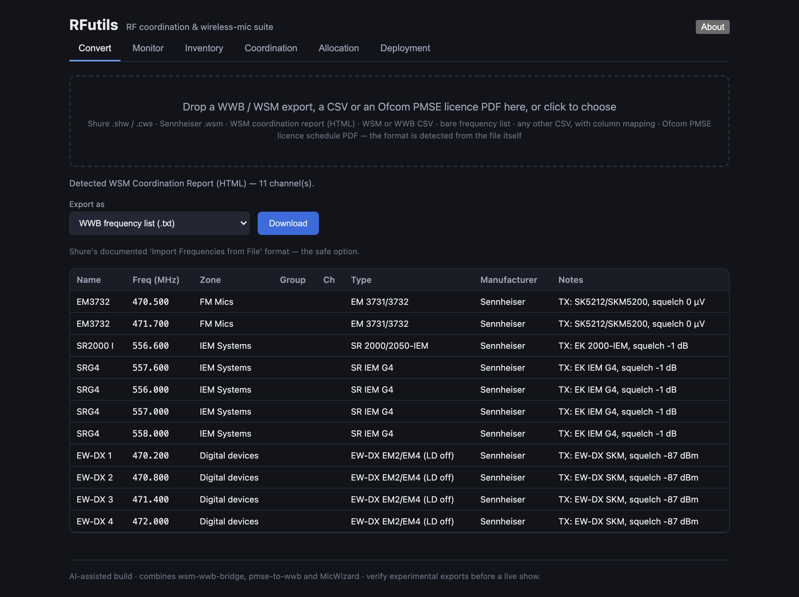
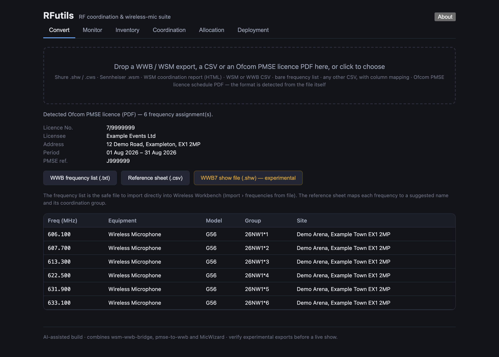

# RFutils user guide

RFutils is a browser-based toolkit for radio mic frequency coordination. It replaces three
separate tools with one app: file conversion between Shure and Sennheiser ecosystems, Ofcom PMSE
licence import, live receiver monitoring, intermodulation-clean coordination, allocation, and
programming receivers.

**MicWizard, wsm-wwb-bridge and pmse-to-wwb are retired in favour of RFutils**, which now does
everything they did. If you used MicWizard or the bridge, start with [Coming from MicWizard or wsm-wwb-bridge](#coming-from-micwizard-or-wsm-wwb-bridge).

> **Before you rely on this for a show:** most of the file formats RFutils reads and writes are
> *reverse-engineered from real exports*, because neither Shure nor Sennheiser publishes full
> specifications for them. **Open every export in your own copy of Wireless Workbench or WSM and
> check it before the show.** Anything marked experimental means it.

---

## The tabs

| Tab | What it's for | Needs the local app |
|---|---|---|
| **Convert** | Move coordination data between Shure Wireless Workbench (WWB) and Sennheiser Wireless Systems Manager (WSM), in and out of plain CSV, or turn an Ofcom PMSE licence schedule PDF into importable frequency data — one drop zone, the file's type is detected | no |
| **Inventory** | Keep a list of the receivers and transmitters you own | no |
| **Coordination** | Calculate an intermodulation-clean set of frequencies | no |
| **Allocation** | Work out which frequencies go to which channel | no |
| **Monitor** | Discover Shure/Sennheiser/AES67 receivers and watch audio, battery and RF | **yes** |
| **Deployment** | Push assignments out to real receivers | **yes** |

> **Monitor and Deployment need sockets a browser tab can't open**, so they only appear in the
> desktop/self-hosted build. The hosted version at
> [rfutils.stoatworks-labs.com](https://rfutils.stoatworks-labs.com) runs everything else entirely
> on your own machine, and nothing you load is uploaded anywhere.

---

## Running it

### As a desktop app

RFutils comes as a tray application (built on av-launcher, with a Node runtime embedded). Start
it, pick a network interface and port, press **Start**, then **Open**.

> **On macOS, if the app opens but the server never starts:** it's almost always Gatekeeper,
> though that shouldn't happen with a released build any more, since the `.dmg` and `.pkg` are
> Developer ID-signed and notarised. On a copy you built yourself, or an older download, the catch
> is that approving the *app* doesn't unquarantine the *helpers* bundled inside it, and they get
> killed silently, with no error shown. `xattr -dr com.apple.quarantine` on the whole bundle
> clears it.

### From source

```bash
npm install
npm run dev
```

Then open **http://localhost:5273**. That's the Vite dev server, which passes the API through to
the RFutils server on port 8420. The desktop app and a production build serve everything from
the server's own port, 8420 by default.

**No hardware? Use demo mode:**

```bash
npm run dev:demo
```

This runs with simulated receivers, so you can explore discovery, monitoring and the whole UI
without a single real device on the network. It's also the quickest way to tell an app problem
from a network problem.

---

## Coming from MicWizard or wsm-wwb-bridge

| You used | Now use | What changes |
|---|---|---|
| **wsm-wwb-bridge** | **Convert** | Nothing you need to do. The same formats in and out, the same column-mapping step for an unfamiliar CSV, and the same output byte for byte — RFutils is tested against the bridge's own results. The exception is the WSM CSV, which WSM 4.9.0 wouldn't import from the bridge: RFutils fills in the priority and squelch level the way WSM's own export does, and lets you pick the priority. It also runs in the hosted page, with no install. |
| **MicWizard** | **Monitor** | It runs in your browser: open it on the same machine as `http://localhost:8420`. Your Companion setup moves (below), and USB-input mappings need setting once more. |

### Moving your Companion setup from MicWizard

MicWizard kept `companion-routes.json` in its own app folder:

- macOS: `~/Library/Application Support/MicWizard/`
- Windows: `%APPDATA%\MicWizard\`
- Linux: `~/.config/MicWizard/`

RFutils reads it from `~/.rfutils/` instead (or the folder set in `RFUTILS_CONFIG_DIR`). The file
itself hasn't changed, so your Companion buttons keep working once it's there:

- **The easy way:** go to **Monitor**. While RFutils has no Companion setup of its own and
  MicWizard's file is still on the machine, the Dante routing panel shows **Import from MicWizard**.
  It copies the file across once, checks it first, leaves the original where it is, and never
  overwrites a setup RFutils already has.
- **By hand (macOS):** `mkdir -p ~/.rfutils && cp ~/Library/Application\ Support/MicWizard/companion-routes.json ~/.rfutils/`

### USB inputs

MicWizard remembered which USB-interface input each analogue receiver was patched into inside its
own window, so those mappings don't come across. In **Monitor**, click 🎧 on each of those
channels once and choose the input again (see [Listening on headphones](#listening-on-headphones)).

---

## Converting a coordination file

1. Go to **Convert**.
2. Drop in your `.shw`/`.cws`, WSM export or CSV. The format is detected automatically, so there's
   nothing to choose first, and the same zone takes a licence PDF (next section).
3. For a plain CSV, RFutils reads the header and suggests which column is which. **Check the
   suggested mapping**: it's a best guess from the column names. If it couldn't guess anything,
   the table starts empty and fills in as you map the name and frequency columns.
4. Choose your export format and download. For a WSM CSV, also pick the priority WSM gives the
   frequencies in its coordination. Medium is what WSM gives a frequency you add by hand; High
   suits licensed frequencies you want it to use first.
5. **Open the result in WWB or WSM and confirm it looks right** before using it.



---

## Importing an Ofcom PMSE licence

1. Go to **Convert**.
2. Drop in the licence schedule PDF as Ofcom issued it, untouched. RFutils recognises a PDF from
   its contents, so it doesn't matter what the file is called or whether it still has its `.pdf`
   extension.
3. If you get *"No frequency assignments were found in this PDF"*, the file was readable but
   isn't the document it expected. Check you've dropped in the schedule itself rather than a
   covering letter or a re-saved copy.
4. Export to your coordination software.



This parser **has been validated against a real Ofcom licence**, which is more than I can say
for most of the formats here.

---

## Coordination

Coordination works out a set of mutually compatible frequencies: spaced apart, clear of excluded
spectrum, and free of third and fifth-order intermodulation products.


Pick an **equipment profile** and a **band preset** and the spacing defaults follow from the
profile. The note under the selector gives the occupied bandwidth and recommended spacing it's
assuming, and tells you to check them against your own unit.

**Locked / existing** is the field that matters on a site where somebody else is already on air:
frequencies you put there are treated as immovable and everything else is coordinated around
them.

---

## Inventory

The receivers and transmitters you own, so coordination and allocation have something real to work
against.


Where RFutils has the maker's band list for a model, **Band** is a list of those bands with their
frequencies: pick the one printed on your unit. **Coordinate from inventory** on the Allocation tab
then keeps each channel inside its own band, gaps included. Anything with no band picked, or with a
band typed in by hand, still gets the band preset most of your gear suggests (470–608 MHz for
nearly all of it), so check those yourself.

> **Saving inventory replaces the whole list** rather than merging into it. The app always writes
> the complete set.

---

## Monitor

Monitor finds Shure, Sennheiser and AES67/Dante receivers on the local network and meters audio,
battery and RF per channel in real time.


*Captured against `npm run dev:demo`, so the receivers are simulated.*

If nothing appears, check that RFutils and the receivers are on the same subnet, that no firewall
is blocking discovery, and that the wireless network isn't isolating clients from each other.

> **What has and hasn't run on real hardware.** None of the Monitor adapters has been run against
> a real receiver yet. Shure discovery and metering follow Shure's published Command Strings, and
> cope with channel names that have spaces in them. Sennheiser receivers found on the network get
> connected to and read every second, but what RFutils asks them for is a best guess at
> Sennheiser's SSC paths, and it's only been tested against a simulated receiver. If you've got
> either to hand, a short capture would help (see the [capture guide](capture-guide.md)).

### Listening on headphones

Every channel has a 🎧 button, and the **Headphone cue** bar above the receivers controls how it
plays:

- **Solo** (ticked by default): one channel at a time, so clicking 🎧 on another replaces the
  first. Untick it to **mix** several; each playing channel shows its own level next to its 🎧.
- **Output**: choose headphones, a USB interface or any other output your computer has. This works
  in Chrome and Edge; Safari and Firefox always use the system output, and the bar says so.
  **Show device names** appears while the browser is still hiding them. It asks once for
  microphone permission, which is the only way a browser will give them up.
- **Stop all** stops every cue.

Where the sound comes from depends on the channel:

- **Dante / AES67 channels** play straight away (the RFutils server relays them).
- **With a Dante interface set up for capture** (see the README), any channel plays: RFutils asks
  Companion to route it to the cue bus. There's only one cue bus, so in Mix those channels still
  replace each other.
- **A receiver with no network audio** (an analogue unit patched into a USB audio interface) needs
  setting up once: click its 🎧 (shown with a dashed border), choose the interface, and pick
  either the whole device or the one input the receiver is plugged into. From then on 🎧 plays
  that input. This browser remembers the choice; **×** next to the button forgets it.

> **Open RFutils at `http://localhost:8420` on the machine it runs on** if you want to listen.
> Browsers only allow audio devices on a secure page, which `localhost` is and an address like
> `http://192.168.1.20:8420` isn't. From another computer the cue is the one thing you can't use,
> and the bar explains that rather than failing silently.

Solo and Mix, the output choice and the USB path have been tried with simulated devices in
Chrome, but not yet with a real USB interface, a real receiver or Safari/Firefox.

### Dante routing

**Dante routing is off unless you set it up.** RFutils only monitors by default. Routing channels
from here needs your own Bitfocus Companion with a "Make Crosspoint" button and a
`companion-routes.json` in `~/.rfutils/`. The panel says so when it isn't configured, and offers
**Import from MicWizard** if MicWizard's copy of that file is still on the machine.

---

## Deployment — read this before you press it

**Deployment sends commands to real receivers, which may be in use.**


**Dry-run** shows precisely what would be transmitted (the address, the literal command string,
and "would send" against each one) without transmitting anything. **Program devices** is a
separate button, kept distinct on purpose, and it's the one that actually sends.

> **Live Shure programming is experimental and untested against hardware.** The dry-run output
> is there so you can check the exact command strings against your receiver's own Command Strings
> PDF before sending. Do that.

The control transports supported today are Shure command strings and the Lectrosonics network
protocol. Devices that match neither are listed with no transport and won't be programmed. The
same screen also exports files for offline programming, which is the safe route.

---

## Troubleshooting

| Symptom | Cause |
|---|---|
| **Nothing is discovered in Monitor** | Same subnet, firewall, or client isolation on wireless. Run `npm run dev:demo` — if simulated devices appear, the app is fine and the problem is the network. |
| **Monitor and Deployment tabs are missing** | You are on the hosted build. Those two need the local app. |
| **A CSV imports with the wrong values in the wrong fields** | The column mapping guessed wrong. Re-import and set it by hand. |
| **An export doesn't look right in WWB/WSM** | Expected occasionally — these formats are reverse-engineered. Please report it with a sample file. |
| **Coordination returns fewer frequencies than asked for** | The constraints are unsatisfiable in that range. Widen the tuning ranges, reduce spacing, or drop 5th-order avoidance. |
| **Frequencies clash with someone already on air** | Put theirs in **Locked / existing** and coordinate again. |
| **The port is already in use** | Set `RFUTILS_SERVER_PORT` to something else. |
| **I just want the converters** | Set `RFUTILS_DISABLE_MONITOR=1`, or run `npm run dev:verify`. |
| **🎧 says cueing needs a secure page** | RFutils was opened by its network address. Open it as `http://localhost:8420` on the machine it runs on. |
| **🎧 on a USB-mapped channel says the input is not connected** | The interface was unplugged or the browser renamed it. Replug it, or press **×** and map the channel again. |
| **No sound, but the 🎧 level is moving** | Check the **Output** in the cue bar — the sound may be going to another device. |
| **Something else went wrong** | Collect diagnostics (next section) and attach the file to your report. |

### Collecting diagnostics

At the bottom of every page, open **Diagnostics** and press **Collect diagnostics**. Your browser
downloads one file holding the logs, the app version, your settings with any passwords removed,
and details of any recent crash. Attach that to your bug report. A copy also stays on the machine
RFutils runs on, and **Open log folder** shows it (on macOS it's in `~/Library/Logs/rfutils/`,
which Finder hides by default).

---

## Where your data lives, and who can reach it

Inventory is stored server-side in the local app.

> **There's no authentication, and the server listens on all interfaces by default.** On a shared
> or untrusted network, bind it to `127.0.0.1` or firewall the port. Otherwise anyone who can
> reach it can read your inventory and **send commands to your receivers**.

---

## See also

- [README](../README.md): what it is, the three tools it replaces, and downloads
- [wsm-wwb-bridge](https://github.com/stoatworks-labs/wsm-wwb-bridge): the standalone Python
  predecessor of the Convert tab, now retired in its favour
- [MicWizard](https://github.com/stoatworks-labs/MicWizard): the Electron predecessor of the
  Monitor tab, now retired in its favour
